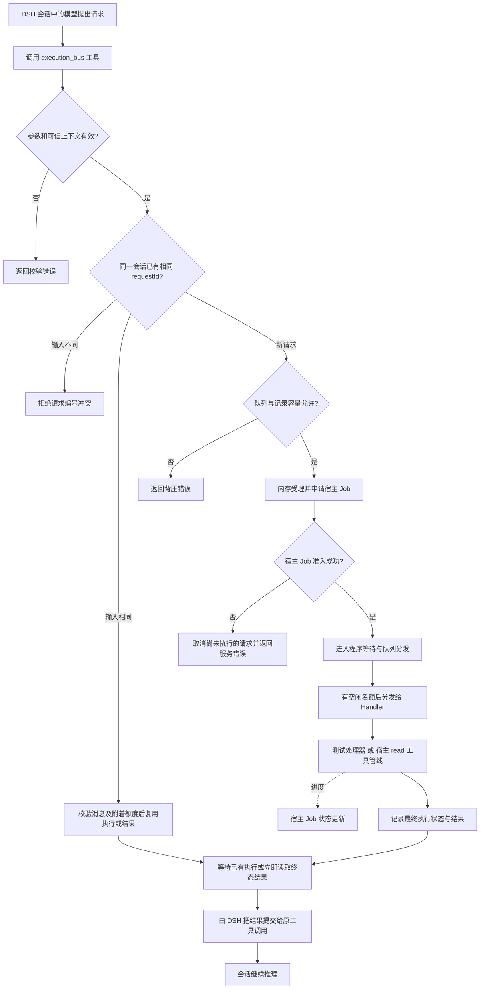
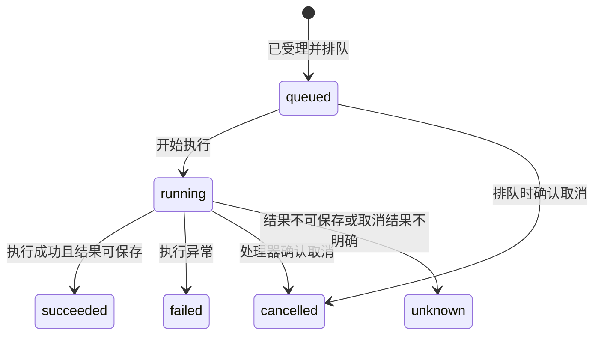

# 萧何 / Xiao He

**让模型发出一次执行请求，由程序负责排队、等待和收取结果。**

“萧何”是产品与模式显示名，执行总线是其技术功能；不新增人物 Agent，不进行角色扮演。仓库 dsh-execution-bus、npm 包名、execution_bus 工具名及 execution-bus-test 预设 ID 保持不变。历史版本发布说明保留当时名称。

DSH 独立插件：`@feng0531/dsh-execution-bus` · 当前版本 **0.11.3**

> 萧何模式从宿主已声明的 PTC 组合派生，保留日常工具，再叠加可选执行总线。已验证隔离的真实 Node PTC → 原 read + 总线调用，以及脚本模型内存会话；真实模型、桌面界面与实际沙箱仍未验收。**不支持重启后恢复任务。**

## 它解决什么问题？

执行一个稍慢的任务时，模型不应该反复问“做完了吗”，也不应该因为等得久就重新执行。执行总线把这些协调工作交给程序：

| 问题 | 执行总线的处理方式 |
|---|---|
| 请求提交后不知道是否接收 | 校验参数后受理；队列满则明确拒绝，不假装成功 |
| 任务还没完成，模型反复查询 | 原工具调用保持异步等待，完成后才返回 |
| 同一次请求重复提交 | 在同一会话、同一存活实例和保存期内，共用一次执行 |
| 重复或迟到的进度到达 | 按序号处理，忽略旧进度和终态后的进度 |
| 取消时不确定任务是否真的停了 | 区分“已请求取消”和“已确认取消” |
| 长任务超出 `run_code` 的时间预算 | PTC 程序结束时只停止等待，已受理执行继续；用同一 requestId 的 `status`/`result` 取回，或用 `cancel` 取消 |

它只是**执行协调层**，不是新的模型或 Agent，不是工作流引擎，也不是对所有工具的全局拦截器。它不能解决模型理解错误、反复改变方案等推理问题。

## 它如何运作？

可以把它理解为一个“执行服务台”：会话递交带编号的请求，服务台排队，指定处理器执行，最后把回执交回原来的窗口。

### 一次请求的完整流程



上图表示正常执行路径；工具校验、策略拒绝、取消或服务异常可能令外层调用返回错误，不能把箭头理解为每次请求必然执行成功。已保存的终态结果复用不申请新 Job。

**图里的“等待”不是阻塞宿主线程，也不是让模型不断查询。** 工具返回的是一个尚未完成的异步操作，DSH 在它完成后继续。队列执行与等待同时进行；进度更新走宿主任务机制，不把每条进度变成聊天消息。正常已等待的 Job 完成通知可由宿主抑制；等待服务故障时不承诺没有额外宿主通知。

若阅读器不支持 Mermaid，上图的主线是：

```text
模型提出请求 → 工具校验 → 内存排队 → Handler 执行
                                         │
                       进度 → 宿主 Job 状态
                                         │
原工具调用保持等待 ← 最终状态与结果 ←──────┘
         │
         └→ DSH 提交原调用结果 → 会话继续
```

### 谁负责什么？

| 部分 | 责任 |
|---|---|
| 模型 | 提出请求，收到结果后继续判断 |
| 执行总线 | 请求编号、排队、并发、重复请求、状态和结果保存 |
| Handler（处理器） | 完成某一种具体工作，响应取消并报告进度 |
| DSH 宿主 | 工具调用身份、权限、执行管线、Job 任务状态和原调用结果提交 |

**受理 ≠ 执行成功，执行完成 ≠ 会话已经收到结果。** 插件只沿原工具调用返回，不通过追加聊天消息伪造恢复。

## 现在能执行哪些任务？

| Handler 名称 | 用途 | 输入 |
|---|---|---|
| `test`（诊断，非业务） | 仅在明确诊断时检查延迟、进度、成功、失败和取消 | `delayMs`：0–30000；`fail`：布尔值 |
| `host.read` | 经由 DSH 现有 `read` 工具读取文本 | `file_path`；可选 `offset` 和 `limit`，最多 100 行 |
| `host.glob` | 经由 DSH 现有 `glob` 工具按路径模式查找文件（只读） | `pattern`；可选 `path` |
| `host.grep` | 经由 DSH 现有 `grep` 工具检索文件内容（只读） | `pattern`；可选 `path`、`include`（单个正向 glob） |
| `host.edit` | 经由 DSH 现有 `edit` 工具替换文本（有副作用） | `file_path`、`old_string`、`new_string`；可选 `replace_all` |
| `host.write` | 经由 DSH 现有 `write` 工具写入文本（有副作用） | `file_path`、`content` |
| `host.pwsh` | 经由 DSH 现有 `pwsh` 工具执行 PowerShell 命令（有副作用） | `description`、`command`；可选 `timeoutMs`、`workdir`、`run_in_background`、`sandbox_permissions`、`justification` |

`host.*` 在出队时重新进入宿主工具管线，沿用宿主当前权限、会话工作目录、沙箱与输出限制。`host.read`/`host.glob`/`host.grep` 只读且幂等，同一 requestId 的终态结果可复用；`host.edit`/`host.write`/`host.pwsh` 有副作用，显式声明非幂等：同一 requestId 的终态结果不可复用，重复提交返回 `MUTATING_REUSE_DENIED`。`host.pwsh` 的后台模式只返回宿主 Job ID，不代表命令完成。插件不自行实现文件或命令执行端，只转发到宿主现有工具；也不提供任意远程执行服务，不会强制将现有工具改成总线调用。

## 选择“萧何”预设

正式模式入口为 `/mode`。新生成预设在原 PTC 组合末尾追加以下行，它不是整份预设：

```yaml
- id: xiao-he-execution-bus
  name: '@feng0531/dsh-execution-bus/mode'
```

旧 /test-mode 保留为兼容别名，两个入口指向同一正式模块，不表示测试专用模式，也不要同时配置新旧两行。必须先安装 0.5.1 或以上才能使用 /mode；旧包没有此导出。旧预设不会自动重写，旧入口继续有效。历史预设 ID execution-bus-test 和包级配置行 ID 不改，避免已有会话失联。

包内提供标准 DSH bundle patch（预设组合补丁）。宿主正常加载后会收到“萧何 / Xiao He”预设定义，由既有设置 → Agent 预设 → **自定义**列表展示。建议选择它新建专门会话，不改默认选择或正在使用的普通会话。已有会话的切换受宿主空白会话检查约束。**实际桌面卡片展示尚未验收**，不能把注册表测试当作界面已通过。

**0.3.0 起不再是只读验证模式。** 加载时读取宿主 `ptc` 预设的组合声明快照，保留原工具、平台表达式、禁用项和配置，只追加萧何总线与说明。不再强制 native 呈现或添加只读白名单；终端、写入、搜索、技能等能力是否可用，取决于原 PTC 配置和宿主服务。其他预设和默认模式不被修改，原 PTC 会话看不到新增总线。

普通任务仍通过 `run_code` 调用原工具；**总线目前只支持 test 与 host.read/host.glob/host.grep/host.edit/host.write/host.pwsh，不接管其他工具、安装或全部能力**。例如更新插件应使用原终端能力并遵守宿主授权；专用插件管理工具若在源 PTC 中禁用，萧何不会擅自启用。命令受理或返回 Job ID 不等于执行完成。

升级提示：预设 ID 保持兼容，但从旧版只读模式升级后能力范围扩大，使用者须审阅后加载；本次不自动升级日常配置。它不是进程沙箱，同一预设会话共享总线容量，结果按会话隔离。派生是加载时快照，不自动跟随源预设热编辑；源 PTC 更新后应按宿主正常流程重新加载派生行，旧会话遵循宿主版本保留规则。

源组合中的相对模块名、include 子文件缺少公开基准地址信息，当前明确拒绝派生，不能称为兼容所有自定义 PTC。遇到该诊断应先将源组合整理成可解析的显式模块行，不能绕过或回退成只读工具集。缺失 ptc 声明时注册器最多等候约 5 秒后明确失败。

**不要同时把包根入口作为全局工具插件加载**：那是手工集成入口，会使 execution_bus 全局可见，失去此预设的可见性隔离。仅安装 npm 包也不保证卡片立即出现，需要加载包声明的 bundle patch。项目发布不会自动安装到任何读者的宿主，卡片是否可用需要在目标实例实际检查。

## 安装前先确认

- 兼容目标：**DSH 0.2.1-rc.2 / Cordis 4.0.4**，Node.js 22 或以上。其他宿主版本未承诺兼容。
- 建议先选择**隔离的 DSH 配置**试用，不直接更改日常环境。
- 目标组合需要可见的工具注册表、Job 服务、现有 Job 控制工具；读取、搜索、编辑、写入或命令任务还需要宿主对应的 `read`/`glob`/`grep`/`edit`/`write`/`pwsh` 工具。
- 安装 npm 包不等于插件已经加载；**只有当前会话能看到 `execution_bus` 工具，才可直接调用。**

### 安装步骤

1. 备份目标配置、依赖声明和锁文件，记录当前插件清单。
2. 在你选定的隔离 DSH 配置依赖目录安装固定版本，不要在 DSH 程序安装目录执行：

   ```powershell
   npm install --ignore-scripts @feng0531/dsh-execution-bus@0.11.3
   ```

   这是 npm 目录示例。若目标配置使用 pnpm，应沿用其包管理器，不混用锁文件。遇到宿主 peer 版本冲突就停止，不用强制安装绕过。

3. 使用宿主插件管理器的 bundle 安装机制加载本包声明的补丁。手工维护配置时，将包加入目标配置的既有 dsh.profile.bundles，并沿用该配置的包管理器；不要把包根入口加入全局工具行。其补丁只插入独立预设，不替换已有模式或默认选择。
4. 按宿主正常方式加载，由你决定是否需要重载或重启。确认本会话出现 `execution_bus` 后再测试。

**发布或本仓库测试不会替你安装、升级或重启 DSH，也不需要修改 DSH 源码或 ASAR。**

## 先跑一个例子

插件加载后，让 Agent 调用 `execution_bus`，参数如下。它会等待处理器完成，而不是立即只返回任务编号。

### 例一：约一秒后成功

```json
{
  "protocolVersion": 1,
  "messageId": "message-001",
  "requestId": "operation-001",
  "type": "request",
  "payload": {
    "handler": "test",
    "input": { "delayMs": 1000, "fail": false }
  }
}
```

完成后，返回值中的 `state` 为 `succeeded`，`result` 为 `{ "ok": true }`。把 `fail` 改成 `true` 并使用新的 `requestId`，可以验证失败路径。不要为了等待这个例子而循环调用 `status`。

### 例二：读取会话工作目录中的文本

保留上面的消息结构，使用新的消息编号和请求编号，将 `payload` 改为：

```json
{
  "handler": "host.read",
  "input": { "file_path": "README.md", "limit": 20 }
}
```

相对路径由宿主当前会话工作目录解析，不由模型指定新的工作目录或权限。读取敏感文件的内容仍可能进入宿主会话记录，请只请求确有需要的内容。

### 两种编号不要混淆

- **`messageId`：这条消息的编号。** 新操作/控制消息使用新编号；同一条消息的重复投递可沿用原编号及原内容。
- **`requestId`：这一次逻辑操作的编号。** 同一次操作重发沿用它；不同操作必须换编号，即使参数完全相同。

同一 `requestId` 搭配不同输入会被拒绝；不同会话不能读取或取消彼此的任务。重复执行保护仅在当前插件实例和保存期内有效，不是永久保证。

### 查询、重取和取消

这三个入口用于人工诊断或恢复当前实例中的结果，**不是正常执行所需的模型轮询步骤**：

```json
{
  "protocolVersion": 1,
  "messageId": "message-002",
  "requestId": "operation-001",
  "type": "cancel",
  "payload": {}
}
```

将 `type` 换成 `status` 查询状态，换成 `result` 重取保存结果；两者都立即返回当前快照，运行中不会替你等待终态。该示例如果在前面的成功请求之后执行，任务早已完成，取消只返回原终态；要验证运行中取消，需要由另一个并发控制调用在任务未完成时发出。取消中的任务要看最终 `state`；`cancelRequested: true` 只表示取消请求已经发出，不表示任务已停止或副作用已撤销。

### 如果宿主使用 PTC 模式

PTC 是 DSH 的程序化工具调用入口。在 `run_code` 内使用 `await tools.execution_bus(请求对象)`，而不是直接调用折叠后的工具名。执行总线不会解除 `run_code` 自身的时间预算。已有真实 Node PTC 隔离进程读文件和调用总线的验证，但尚未进行实际模型/桌面沙箱全链路验收。

**0.11.0 起，总线改为收益导向触发并支持简化调用。** 只在能获得协调收益时使用：同一逻辑操作可能重复提交或需要重试去重（沿用 requestId）、任务需要在 `run_code` 预算结束后继续/跨步骤取回、或多个步骤与等待者需要同一执行结果；**“操作耗时长”本身不是理由**，一次性长命令请用原工具或宿主后台 Job。工具入口支持简化调用 `{requestId, handler, input}`（messageId 可省略、自动生成）和控制 `{requestId, type:"status"|"result"|"cancel"}`，完整 v1 消息仍被接受；返回快照在复用时带 `reused: true`。工具声明仍是按 Handler 的判别联合，PTC SDK 与原生声明里可直接看到每个 Handler 的必填字段。

**跨步骤取回的正确姿势（0.11.1 补充）：** 同一 `run_code` 程序内，未完成的 request 会阻塞后发工具调用的结果提交（宿主按提交顺序结算）；不要在同一个程序里“启动后立刻 status 轮询”。启动步骤只发请求并尽早结束程序，下一步再用同一 `requestId` 的 `status`/`result`（或重发同一 request）附着取回——pilot 实测单次执行、返回 `reused:true`。

**0.9.0 起，预算到期不再连带取消已受理执行。** `run_code` 因时间预算到期或程序结束时，宿主会中断其中的工具子调用；总线把这种中断视为**只停止等待**：已受理执行与宿主 Job 继续，程序返回预算错误后，可在后续 `run_code` 中用同一 `requestId` 的 `status`/`result` 取回结果，或用 `cancel` 取消。用户主动中断、会话取消、沙箱模式变化等其他原因仍会请求取消整个执行。该识别依赖 DSH 0.2.1-rc.2 的中断原因字符串（见[宿主兼容性](<docs/host-compatibility.md>)），不是宿主公开稳定契约；进程退出仍会丢失全部内存状态，保留期一小时。

## 如何理解任务状态？



| 状态 | 含义 |
|---|---|
| `queued` | 已受理，尚未执行；不代表成功 |
| `running` | 正在执行；等待窗口超时不自动把它变成失败 |
| `succeeded` | 执行成功且总线保存了结果 |
| `failed` | 处理器失败，或排队期限到达但尚未执行；查看 error 区分 |
| `cancelled` | 已确认取消 |
| `unknown` | 不能可靠保留或确认结果，不可盲目重跑有副作用操作 |

执行终态不会再改成另一个终态。取消与成功竞争时，若处理器最终正常返回，仍可能是成功。`delivery` 是另一个字段：`pending` 表示尚未走到返回标记，`returned` 只表示插件已走到工具返回路径，**不证明会话结果已经写入磁盘或模型已经消费**。

## 调度与诊断

0.4.0 起对已受理的排队请求按会话轮转，同一会话保持 FIFO；0.5.0 再增加每会话准入配额与排队期限。不抢占运行任务，也不保证队列满时为其他会话预留名额。执行结果仍由 core 唯一提交，宿主 Job 只负责任务展示、控制与生命周期关联。

core 开发者可调用实例 `diagnostics()` 取得队列、运行数、保留结果字节及最近 128 条数值阶段轨迹。不含请求/会话 ID、输入、输出或错误文本，不写日志；诊断不增加模型调用工具，也不是跨重启审计记录。详见[优化范围与验证](<docs/OPTIMIZATION.md>)。

### 查看本会话状态

在 PTC 中按需执行 `return await tools.execution_bus_state({})`，仅在用户诊断时调用，不循环轮询。返回本会话排队/运行/终态数量、默认策略，以及最多 50 条任务元数据（活跃优先，其余最近受理的终态优先）。有 requestId、状态、等待原因、取消标记、单调时钟时长、固定错误码和 delivery，不含输入、结果或其他会话信息。delivery 不是模型已消费回执，也不能从视图断言 Job 正在清理。

core 开发者可用 `new ExecutionBus(options, {sessionQueueLimit:16,maxQueueWaitMs:120000})` 和 `inspect(trustedOwner)`；第二参数省略时保持旧版无限会话配额/无排队期限行为，原五项 options 不变。该可信 owner 由调用者提供，core 不是身份认证边界，宿主工具从真实 Agent 取得身份且只接受空对象。

## 容量与重要限制

宿主插件默认并发 **2**，全局排队上限 **32**，每会话排队上限 **16**；排队超过 **120 秒**且尚未开始执行时结算为 `failed / QUEUE_WAIT_TIMEOUT`，不调用 Handler。运行后不会被该排队期限中止，PTC 外层仍有独立时间预算。最多保存 **256** 条任务记录，单结果最多 **64 KiB**，完成结果保留期 **1 小时**，在新请求和查询时惰性清理；不是一小时一到即定时删除。队列或记录满时拒绝新任务；宿主 Job 自身也有容量限制。

- **全部状态在内存中。** 受理没有落盘，插件关闭或进程崩溃后，不能依靠它恢复原调用或保证请求不丢失。
- **预算分离等待不是持久化。** PTC 程序结束后继续执行的任务只在当前插件实例存活期间有效；进程关闭即丢失，结果最多保留一小时，不保证模型一定取回。
- **不自动重跑任务。** 通信超时不等于执行失败，取消不等于回滚。Job 等待服务异常会在原执行排空后返回服务错误，执行可能已成功；应核对原 requestId 的状态，不要换编号盲目重跑。
- **不承诺端到端 exactly-once。** 当前实例的请求复用不能代替外部副作用对账。
- 当前没有远端执行端、跨插件 Handler 注册服务或非幂等操作对账能力。
- 未证明真实模型轮次、主动查询次数或总耗时的提升比例。

## 不安装也能测试吗？

可以。开发者在本仓库运行：

```powershell
npm ci --include=dev --ignore-scripts
npm run test:flow       # 流程回归 + 真实宿主组件 + 脚本模型驱动的 AgentLoop
npm run check           # 全量编译和测试
npm run verify:package  # 检查公开包内容
npm run test:install    # 临时目录安装，不操作日常 DSH
```

这些测试不等于“当前聊天会话直接调用插件”。真实 AgentLoop 测试使用脚本模型适配器；工具组件测试使用测试 Agent。具体边界见[流程测试说明](<docs/FLOW-TEST.md>)。构建候选安装包可运行 `npm run pack:candidate`。观察本机真实会话的总线采用率可运行 `npm run metrics:sessions`（只读扫描会话日志，统计各会话的请求类型、Handler、复用标记与错误）。

## 卸载与回滚

先停止新请求，等待已有任务完成或请求合作取消，再从目标实例加载配置中移除插件，按宿主生命周期卸载。不要强杀后假定外部工作已撤销。

若试用失败，恢复安装前备份的配置、依赖声明和锁文件，由你决定何时重新加载实例。内存结果会丢失；宿主已有会话日志不属于本插件卸载范围，不要删除。

## 进一步阅读

- [产品结构与兼容契约](<docs/PRODUCT.md>)：正式入口、模块职责及维护验收边界。

- [协议和投递语义](<docs/protocol.md>)：字段、状态、重复处理与取消规则。
- [宿主兼容性与源码调用链](<docs/host-compatibility.md>)：为什么可以等待，为什么不能跨重启恢复。
- [验证记录](<docs/validation.md>)、[0.11.3 发布说明](<docs/releases/0.11.3.md>)：已验证与未验证范围。
- [同类项目源码整合](<docs/INTEGRATION.md>)：固定来源、采用范围、许可与验证边界。
- [维护者发布流程](<docs/RELEASING.md>)：标签 CI、安装包校验与正式发布门禁。

## 许可

采用[非商业源码公开许可证](<LICENSE>)，**不是 OSI 开源许可证**。商业项目内部使用及有偿交付需要另行书面授权；第三方独立依赖仍受各自原许可证约束。
